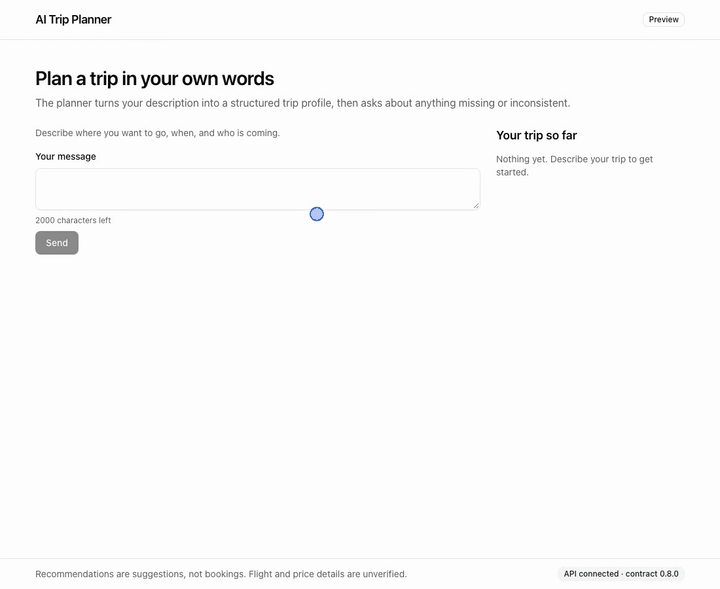
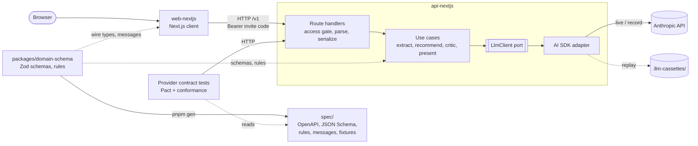

# AI Trip Planner

A portfolio app that turns natural-language travel requests into structured, validated vacation recommendations. It's a showcase for LLM integration: travel requests are messy and open-ended, so a model turns them into structured data, while ordinary code validates that data and decides what happens next.

It's built spec-first. The HTTP contract, the business rules and worked examples of each rule live as language-neutral files in `spec/`. One TypeScript backend implements them, and a Next.js web client talks to it over HTTP only. The provider contract tests check the running backend against the spec over HTTP, without importing any of its code.



*A recorded run of the app in replay mode: a vague request, a clarification, then recommendations. Re-record it with `pnpm record:demo` (needs ffmpeg).*

**In five minutes:** read [How it works](#how-it-works), [Design and tradeoffs](#design-and-tradeoffs) and [Testing](#testing). **In ten:** follow the [Quickstart](#quickstart) to a green gate and a browser running the app.

## Quickstart

You need Node 24.22.1 (pinned in `.nvmrc`) and Git. Everything else comes through pnpm. No API key is needed: every test replays recorded LLM calls.

```sh
git clone https://github.com/djuba/ai-trip-planner.git
cd ai-trip-planner
corepack enable                 # provides pnpm 12.15.0, pinned in package.json
pnpm install                    # also installs the git hooks
pnpm --filter @vp/journeys exec playwright install chromium   # once: the browser tests use it
pnpm verify                     # the project gate: typecheck, lint, every test layer, coverage
```

`pnpm verify` builds both apps and runs every test layer; it takes under a minute on a recent Mac. On Windows, the Pact verifier needs the Microsoft Visual C++ Redistributable (see [Prerequisites](#prerequisites)).

**See the app working**, still with no API key:

```sh
pnpm test:journeys --grep @smoke --headed   # watch a browser go from a vague request to recommendations
pnpm test:journeys --grep @smoke --ui       # or step through it in Playwright's UI mode
```

This builds both apps, starts them in replay mode, and drives the UI the way a user would. Replay can only answer the requests that were recorded, and every recording includes the date the browser sends, so the journeys fix the browser's clock and type the recorded messages. A request you type yourself would find no recording and fail.

**To try your own messages**, you need an Anthropic API key, and each conversation costs a few cents. Copy `.env.example` to `.env.local`, set `ANTHROPIC_API_KEY` and `LLM_MODE=live`, then run `pnpm dev` and open http://localhost:3000. When the app asks for an invite code, enter `local-dev-invite` (it only works on a developer machine; see [access-gate.md](docs/features/access-gate.md)).

**A live demo is available on request.** It runs on the hosted environment, behind an invite code. To try it without an API key, get in touch through [my GitHub profile](https://github.com/djuba), and I will send you a code and the link.

## How it works



The server is stateless, so each stage is its own HTTP request, and the client decides when to call the next one. The client keeps the conversation and sends the current profile with every turn.

| Step | Input | Handled by | Output |
|---|---|---|---|
| 1. Extract | The user's message and current profile | LLM (fast model) | `ExtractionSchema` |
| 2. Normalize | `ExtractionSchema` | Code | `TripProfile`, the domain model |
| 3. Validate | `TripProfile` | Code | `ready`, or violations |
| 4. Clarify | Violations | LLM writes the question | `needs_clarification`, then back to step 1 |
| 5. Recommend | A `ready` profile (otherwise a 422) | LLM drafts (reasoning model); code sets ids and `verification` labels from sample route data | `RecommendationSet` |
| 6. Critique | Recommendations | Code checks first, then LLM, with at most 2 revisions | `RecommendResponse` |
| 7. Present | Profile and recommendations | Code for data, LLM for prose | Streamed `PresentationModel` |

For example, "Somewhere warm" populates only one field, so the rules ask for more detail. "A beach trip in March for two adults and a child" populates three, so it can move on to recommendations.

Model output is treated as untrusted input: every response is checked against its schema, output over a size cap is discarded, and invented specifics such as flight details must be labeled as unverified. Code sets those labels, never the model. There's no live flight or hotel data.

## Design and tradeoffs

Each decision below has a record in [docs/decisions/](docs/decisions/README.md).

**Why the spec is language-neutral** ([ADR 0003](docs/decisions/0003-spec-first-one-implementation.md)). The contract is published as plain files: JSON Schema, OpenAPI and a constants file in `spec/generated/`, plus a Markdown rule catalog (`spec/rules.md`), a message catalog (`spec/messages.md` and `spec/messages/`: how any client words each rule and enum value, as ICU MessageFormat templates) and a normalization spec (`spec/normalize.md`: how model output becomes a profile, including which over-cap values are discarded), each with JSON examples in `spec/fixtures/`. These files are the API docs any client can read. The contract tests read only them, so the tests check the contract rather than how the TypeScript code happens to meet it, and they can check a deployed backend too.

**Who it's for.** First, more clients. A second frontend, such as a native mobile app, can generate its models from the OpenAPI and JSON Schema files, word every rule and enum value the same way from the message catalog, check the size caps before it sends, and read the `/present` stream without the AI SDK, because the stream is plain JSON text. Pact supports many consumers: each client's tests write its own pact, and the backend is verified against all of them. The web client already works this way: its Pact consumer tests write the pact the backend is verified against, it checks every response against the wire schema at runtime ([AC-WEB-04](docs/features/web-client.md)), and its test mocks are built through a schema-checking helper, so they can't drift. Second, other backends: the provider contract tests would judge a new implementation unchanged.

**What it costs.** Shapes are written once in Zod and generated into `spec/generated/`, so the generated files need a drift check, and a parity test keeps Zod and JSON Schema in agreement. Wire schemas are limited to what JSON Schema can express, so cross-field checks live in the rules instead. A test keeps the rule catalog and its examples in step, and the TypeScript tests need a loader (`packages/domain-schema/tests/support/rule-fixtures.ts`) that reads and validates the JSON examples.

**What isn't proven.** Neither benefit. There's one backend and one client, both in TypeScript, and the web client imports the contract package directly instead of reading `spec/`. The provider contract tests (the Conformance and Pact rows below) are black-box, so they would judge a second backend unchanged, but nothing shows one would pass. A client in another language would show its own conformance through its consumer pact and the schemas; none has been built yet.

**Two schemas, not one** ([ADR 0001](docs/decisions/0001-structured-output.md)). The model fills in `ExtractionSchema`, where every field is required but nullable, which is the most reliable shape for structured output. Code turns it into the wire's `TripProfile`. Range and format checks are rules, not schema constraints: one out-of-range value in a constrained schema fails the whole model call, while a rule turns it into a clarifying question.

**Limits as containment** ([ADR 0004](docs/decisions/0004-input-and-output-limits.md)). The model can't be relied on to resist prompt injection, so the code limits what gets out: every string and list in the contract has a cap, and model output over a cap is discarded, never truncated. A request over a cap is a 422, not a clarifying question, so an oversized value is never echoed back.

**Hosting** ([ADR 0005](docs/decisions/0005-hosting-and-access.md)). One environment on Google Cloud Run, which scales to zero, so hosting costs about nothing and the budget goes to the LLM. The API and the web client each ship as a container image, and CI checks the API's against the contract. Deploys use GitHub OIDC and Workload Identity Federation, so no cloud key is stored anywhere; Terraform in `infra/` is applied by hand. There are no user accounts: the trip endpoints need an invite code, and each code has quotas and rate limits, because the risk worth controlling is someone running up the LLM bill.

**Patterns used**

| Pattern | Here |
|---|---|
| Spec-first (contract-first) API design | Shapes are written in `packages/domain-schema` and generated into `spec/generated/` before endpoints implement them |
| Specification by Example | Each rule in `spec/rules.md` has worked examples in `spec/fixtures/rules/` that run as tests. It's the idea under BDD, without Gherkin scenarios written with the business |
| Shared test vectors | The same rule examples drive the rules' unit tests and the `/extract` HTTP tests |
| Consumer-driven contracts | Pact: the web client's tests write the pact, and the backend is verified against it |
| Ports and adapters | `src/usecases/` owns the `LlmClient` port; `src/llm/` holds the adapters (AI SDK with record/replay, and a mock) |
| Record/replay at the HTTP boundary | The Anthropic provider gets a custom `fetch` that records to, or replays from, `.llm-cassettes/`. The SDK and our code run for real; only the network is replayed |

## Testing

Every behavior is tested at the lowest layer that can prove it. No gated test calls a live LLM: unit tests use a mock model, and everything else replays recorded calls. A missing recording fails the test rather than going live.

| Layer | Proves | Fakes | Tool | Volume |
|---|---|---|---|---|
| Journey | The integrated system works for a user | Only the LLM (replay) | Playwright | 4 |
| Contract | The web client and the backend agree on the HTTP contract | The other side | Pact, JSON Schema (Ajv) | One per interaction |
| Functional | One app top to bottom, in-process | Other systems: the LLM (replay), or for the web app, the API (contract-checked mocks) | Vitest, Playwright + axe | A handful per app |
| Integration | One component with its real dependency | Everything else | Vitest, msw | Tens |
| Unit | Logic in isolation | Everything else | Vitest, React Testing Library | Hundreds |

Every feature's acceptance criteria are in [docs/features/](docs/features/), each with a stable ID that starts the title of the test proving it, so `grep AC-EXTRACT-03` finds both. Coverage floors are enforced: 95% for the domain schema and the use cases, 80% elsewhere.

**Gates**

| Gate | Command | Runs | Where |
|---|---|---|---|
| Pre-commit | (lefthook) | Lint and format the staged files, gitleaks secret scan | Every commit |
| Project | `pnpm verify` | Typecheck, lint, format, generated-file drift, dependency audit, unit, integration, functional and contract tests, coverage | Every push (`pre-push`), and CI job `verify` on every PR |
| Image | `pnpm test:image`, `pnpm test:firestore` | Builds the API image, checks it runs as non-root with no secrets, runs the provider contract tests against it; then checks the Firestore usage store against the Firestore emulator | CI job `image`; locally where Docker is installed |
| Infrastructure | — | `terraform fmt`, `init` and `validate`, with no credentials | CI job `infra` |
| Integrated | `pnpm verify:integrated` | Builds both apps, starts them in replay mode, runs the `@smoke` and `@critical` journeys | Locally before a release, and in the deploy workflow |
| Full | `pnpm verify:full` | The `@full` journeys, then the provider contract tests | Locally |
| Deploy | — | Builds and pushes both images; runs the provider contract tests against a replay twin of the API, and the integrated gate; then promotes the same digests to the API and web services, smoke-checks them and rolls back on failure | After each merge to `main` |

`verify`, `image` and `infra` are the required checks for merging. CI holds no credentials; only the deploy workflow gets cloud access, through OIDC. More on the journeys and their runner: [journeys.md](docs/features/journeys.md).

**How the design is checked**

| Check | What it confirms | Where |
|---|---|---|
| Import boundaries | The web app can't import backend code or `rules`; use cases can't import the AI SDK | `eslint.config.js`, `scripts/tests/integration/lint-boundaries.test.ts` |
| Drift check | The generated files match the Zod schemas | `pnpm --filter @vp/domain-schema gen:check` |
| Schema parity | Zod and the generated JSON Schema accept and reject the same payloads | `packages/domain-schema/src/wire/parity.test.ts` |
| Rule examples | The rules return exactly the cataloged violations for every example | `spec/fixtures/rules/`, run by the rules' unit tests and through `/extract` |
| Message catalog | Every rule code and enum value has text in every locale, each template uses only real arguments, and every rule example formats | `packages/domain-schema/src/messages/catalog.test.ts` |
| Normalize examples | Model output becomes exactly the expected profile, with over-cap values discarded | `spec/fixtures/normalize/`, run by `normalize`'s unit tests and through `/extract` |
| Conformance suite | The running backend's responses match the contract | `tests/contract/conformance/`, run by `pnpm test:contract` (or `test:contract:external` for any running backend) |
| Pact | The backend does what the web client expects | The web client's consumer tests (`apps/web-nextjs/tests/contract/`) write `contracts/pacts/`; `tests/contract/pact-verify.test.ts` verifies it |
| Container image | The API image builds from a clean checkout, runs as a non-root user with no secrets, and passes the provider contract tests in replay mode | `backends/api-nextjs/Dockerfile`, run by `pnpm test:image` |
| Deployment check | Each image passes the provider contract tests on a replay twin, through the platform's front end, before it is promoted; a model-free smoke check follows the promotion | `.github/workflows/deploy.yml`, `infra/` |
| Journeys | The whole system works from the user's side: the browser drives the built web app against the built API, which replays recorded LLM calls | `tests/journeys/`, run by `pnpm verify:integrated` and `pnpm verify:full` |

Tests prove plumbing, contracts and rules, not whether a recommendation is good. That is judged separately by an opt-in eval (`pnpm eval`, live, never gated), which scores deterministically first and keeps a history of runs ([eval.md](docs/features/eval.md)).

## Cost control

**In development, nothing gated spends money.** Tests use a mock model or replay recorded calls from `.llm-cassettes/`, and a missing recording fails the test instead of falling through to the live API. Recording new cassettes (`pnpm record:cassettes`) and running evals (`pnpm eval --budget <usd>`, which stops at the budget) are the only paid commands, and both are explicit. A journey recording cost about $0.03.

**Each call is sized.** The fast model (Haiku) does extraction, clarification and presentation; the reasoning model (Sonnet) does recommendations and the critic. Every call sets `effort` (low, or medium for recommend and critic) and a `maxOutputTokens` budget sized from the contract's caps. The critic runs at most two revisions. System prompts are byte-stable, so recordings stay valid. Every call logs its model, stage, tokens and latency.

**Hosted, the risk is spend by someone else.** Cloud Run scales to zero with at most one instance, so idle hosting costs about nothing. Every trip endpoint needs an invite code; each code has a lifetime quota per endpoint and an hourly window, and all codes share a daily window. The server stores only each code's SHA-256 hash. The monthly budget is $5–10 in total, almost all of it for the LLM ([ADR 0005](docs/decisions/0005-hosting-and-access.md)).

## The contract

The HTTP API is versioned under `/v1`, JSON only, and published as [`spec/generated/openapi.yaml`](spec/generated/openapi.yaml), with a JSON Schema per body in `spec/generated/`.

| Endpoint | Request | Response |
|---|---|---|
| `POST /v1/trip/extract` | The message, the current profile, the client's date | `needs_clarification` (profile, violations, a question) or `ready` (profile) |
| `POST /v1/trip/recommend` | A `ready` profile, the client's date | Recommendations, after the critic |
| `POST /v1/trip/present` | Profile and recommendations | A plain-text stream of JSON that parses as `PresentationModel` when complete |
| `GET /v1/health` | — | Status and contract version |

The trip endpoints need `Authorization: Bearer <invite code>`. A business-rule problem is a `200` with `needs_clarification`; errors are `{ error: { code, message } }` with `401`, `413`, `422`, `429` or `502`. Rule violations carry a code and parameters, never text: clients word them from the message catalog.

| File | What it defines |
|---|---|
| [`spec/generated/openapi.yaml`](spec/generated/openapi.yaml) | The endpoints, status codes and bodies |
| [`spec/generated/constants.json`](spec/generated/constants.json) | Every size cap and threshold, so all readers use the same values |
| [`spec/rules.md`](spec/rules.md) | The business rules, each with a stable code, and their examples in `spec/fixtures/rules/` |
| [`spec/normalize.md`](spec/normalize.md) | How model output becomes a `TripProfile`, with examples in `spec/fixtures/normalize/` |
| [`spec/messages.md`](spec/messages.md) | How clients word rule codes and enum values; the templates are in `spec/messages/` |

## Prerequisites

- Node 24.22.1 (pinned in `.nvmrc`)
- pnpm 12.15.0, provided through corepack (`corepack enable`)
- Chromium for Playwright, installed once with `pnpm --filter @vp/journeys exec playwright install chromium`
- To commit: [gitleaks](https://github.com/gitleaks/gitleaks) 8.30.1 on `PATH` for the pre-commit secret scan (`winget install Gitleaks.Gitleaks` or `brew install gitleaks`). Without it, commits are blocked. Running and verifying don't need it.
- On Windows, the Microsoft Visual C++ 2015–2022 Redistributable (x64) for the Pact verifier's native library (`winget install Microsoft.VCRedist.2015+.x64`). Without it, `pnpm test:contract` fails with a message saying so.
- Optional: Docker, only to build and test the API container image (`pnpm test:image`) and the Firestore usage store (`pnpm test:firestore`). `pnpm verify` doesn't use it, and CI always runs both.

## Commands

```sh
pnpm install              # also installs the git hooks (lefthook)
pnpm dev                  # web on http://localhost:3000, API on :4000 (copy .env.example to .env.local)
pnpm verify               # project gate: typecheck, lint, format, audit, tests + coverage
pnpm test:unit            # or test:integration, test:functional, test:contract
pnpm verify:integrated    # integrated gate: build both apps, start them (replay), journeys @smoke + @critical
pnpm verify:full          # nightly-equivalent gate: journeys @full, then the provider contract tests
pnpm test:journeys        # every journey; Playwright arguments pass through (e.g. --grep @full, --headed)
pnpm test:image           # needs Docker: build the API image, check it, contract tests against it
pnpm test:firestore       # needs Docker: the access gate's Firestore usage store against the emulator
pnpm eval --budget 1      # LIVE, costs money: extraction quality and injection evals (never gated)
```

`pnpm record:cassettes --journeys` re-records the journeys (live, costs money), and `pnpm record:cassettes --prune` deletes cassettes no gated suite replays any more (no live calls; review the deletion before committing).

Git hooks: `commit-msg` enforces Conventional Commits with the scopes in [CLAUDE.md §10](CLAUDE.md#10-commits--history), `pre-commit` lints and formats staged files and runs gitleaks, and `pre-push` runs `pnpm verify`.

Use pnpm only; do not use npm or Yarn.

To run the API image by hand, in replay mode (no API key, no LLM cost), then test it. The model IDs are the contract runner's (`CONTRACT_TEST_ENV` in `backends/api-nextjs/tests/support/api-server.ts`): cassette keys include the model ID, so the contract suite's cassettes only replay with these.

```sh
docker build --platform linux/amd64 -f backends/api-nextjs/Dockerfile -t vp-api-nextjs .
docker run --rm -p 4000:8080 -e MODEL_FAST=claude-haiku-5-5 \
  -e MODEL_REASONING=claude-sonnet-5-5 -e MODEL_CRITIC=claude-sonnet-5-5 vp-api-nextjs
pnpm test:contract:external   # API_BASE_URL defaults to http://localhost:4000 in .env.example
```

## Where to find things

| Looking for | Location |
|---|---|
| HTTP request and response bodies | `packages/domain-schema/src/wire/http/` |
| Shared types inside those bodies | `packages/domain-schema/src/wire/models/` |
| Formats only the LLM fills in, which never cross HTTP | `packages/domain-schema/src/wire/llm/` |
| Generated JSON Schema and OpenAPI | `spec/generated/` |
| Business rules | `spec/rules.md` (the spec) and `packages/domain-schema/src/rules/` (the TS implementation) |
| How model output becomes a profile, and input limits | `spec/normalize.md` and [ADR 0004](docs/decisions/0004-input-and-output-limits.md) |
| How clients word rules and enum values | `spec/messages.md`, `spec/messages/<locale>.json`, and `packages/domain-schema/src/messages/` (the TS reader) |
| Language-neutral test cases | `spec/fixtures/rules/` and `spec/fixtures/normalize/` |
| API endpoints | `backends/api-nextjs/src/app/v1/**/route.ts` |
| Business logic for each AI stage | `backends/api-nextjs/src/usecases/` |
| The Anthropic client and record/replay | `backends/api-nextjs/src/llm/` |
| The API container image | `backends/api-nextjs/Dockerfile` and `.dockerignore` (an allowlist) |
| The hosted environment (Terraform) and its runbook | `infra/`, [`infra/README.md`](infra/README.md) |
| The web client | `apps/web-nextjs/` |
| Acceptance criteria | [`docs/features/`](docs/features/) |
| Decision records | [`docs/decisions/`](docs/decisions/README.md) |
| LLM evals: cases, scorers and the results history | `backends/api-nextjs/eval/` ([eval.md](docs/features/eval.md)) |

### How this maps to Clean Architecture

| Clean layer | Here |
|---|---|
| Core | `packages/domain-schema` |
| Use cases | `backends/api-nextjs/src/usecases/`, which owns the `LlmClient` interface |
| Infrastructure | `backends/api-nextjs/src/llm/` |
| Web | `backends/api-nextjs/src/app/v1/**/route.ts` |

ESLint import rules and the package `exports` map enforce the boundaries that project references would in .NET.

### Where tests live

| Test type | Location |
|---|---|
| Unit | `*.test.ts` beside the code |
| Integration | `<project>/tests/integration/` |
| Functional | `<project>/tests/functional/` |
| Helpers shared within a project | `<project>/tests/support/` |
| Provider contract tests, black-box against the running backend | `tests/contract/` |
| Journeys, across the whole system | `tests/journeys/` |

## Documentation

- [docs/decisions/](docs/decisions/README.md): architecture decision records
- [docs/features/](docs/features/): acceptance criteria per feature
- [CLAUDE.md](CLAUDE.md): architecture, testing strategy and engineering rules, as given to the coding agent that builds this repo
- [docs/work-breakdown.md](docs/work-breakdown.md): build order and progress, one work unit at a time
- [docs/plans/](docs/plans/): each work unit's plan, with the deviations found while building it
